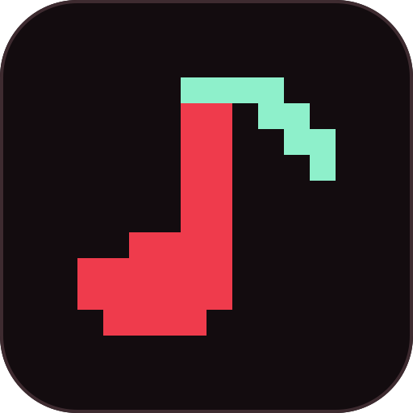
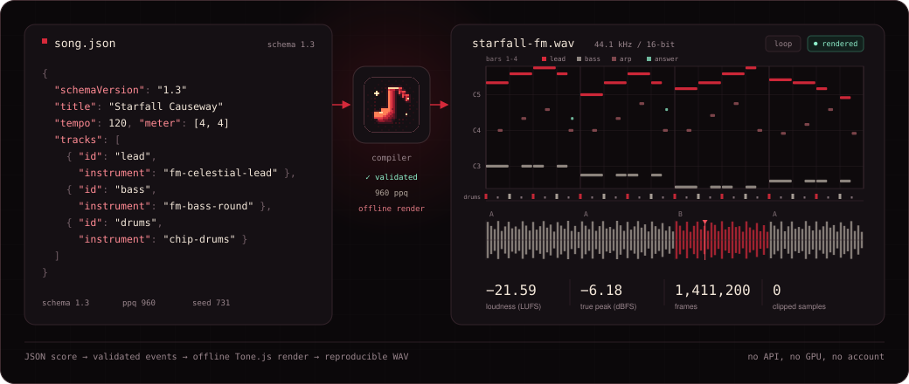

<div align="center">

[简体中文](README.zh.md) · **English**



# Retro Music Toolkit

### An 8-bit / 16-bit game music workstation built for AI agents

**Fully local, no API. The same score always renders the same audio.**

[](#what-it-does-for-you) [](#what-it-does-for-you) [](#what-it-does-for-you) [](#technical-details) [](#quick-start) [](LICENSE)

[🎧 Listen online](https://narrastory.github.io/retro-music-toolkit/) · [Quick start](#quick-start) · [vs. music models](#how-is-this-different-from-a-music-generation-model) · [Technical details](#technical-details)

</div>

<p align="center">
  
</p>

```bash
git clone https://github.com/narrastory/retro-music-toolkit.git
cd retro-music-toolkit/scripts/runtime && npm ci && npm run build
node dist/cli.js example --out song.json && node dist/cli.js render song.json --out song.wav
```

---

## What it does for you

**🔒 Fully local — no model, no account**\
No API key, no GPU, no cloud calls, no per-generation billing. Once dependencies are installed it runs with the network unplugged. Your scores and audio never leave your machine.

**🔁 Reproducible output**\
The same JSON and the same seed render the same audio — today, next year, on another computer. Drum noise, humanize jitter and random arpeggios are all derived from the seed, so you can commit a score to Git and manage music the way you manage code.

**✏️ Change one note without starting over**\
Bass wrong in bar 9? `patch` edits that one note, leaves everything else untouched and returns a per-field change log. You never lose the parts you were happy with.

**🩺 Tells you where it is wrong**\
Non-chord tones on strong beats, bass clashing with the chord, parallel fifths, unresolved leaps, a loop seam that never returns to the opening chord — diagnostics report the bar and the note ID, and often the exact repair value.

> [!TIP]
> Want to hear it first? 👉 **[Listen online](https://narrastory.github.io/retro-music-toolkit/)** (three original tracks: chip battle, pastoral and electronic)
> Every example is rendered offline from a JSON score in this repository. No model was involved.

---

## See it in 60 seconds

```bash
node dist/cli.js example --out song.json     # a ~40-line score that runs as-is
node dist/cli.js render song.json --out song.wav
node dist/cli.js describe song.json          # read the piece's structure as text
```

`describe` gives a structural summary an AI can reason about without hearing anything:

```text
# Starfall Causeway
genesis-inspired, modern voice, 120 BPM, 4/4, 16 bars (64 beats), loop export
- lead (fm-celestial-lead, melody): 60 notes, 3.8/bar, range B4–C6,
  peak C6 at beat 38.00, 37% stepwise motion
- bass (fm-bass-round, bass): 64 notes, 4.0/bar, range F2–D3, peak D3 at beat 40.00
- drums (drums): 128 hits, 8.0/bar — hat×64, kick×32, snare×32
Sections:
  A-1: bar 1, 5.13 events/beat, median E4 — opening
  B-9: bar 9, 4.75 events/beat, median D4 — similar to previous
```

Measured numbers from the render report (Starfall Causeway, FM version):

| Duration | Integrated loudness | True peak | Clipped samples |
| :---: | :---: | :---: | :---: |
| 32.0 s | −21.59 LUFS | −6.18 dBFS | 0 |

---

## How is this different from a music generation model

They solve different problems.

| | Music generation model | Retro Music Toolkit |
| --- | --- | --- |
| **Input** | A text description | A JSON score |
| **Runs on** | Cloud API / local GPU | An ordinary laptop, offline |
| **Cost** | Per generation | Zero |
| **Reproducibility** | Same prompt, different result | Same score, same result |
| **Editing** | Regenerate the whole piece | Change a single note |
| **Explainability** | You get audio | You get a score and diagnostics |
| **Source material** | Training data is not traceable | Procedural sounds plus traceable CC0 / CC BY samples |

**A generation model is good at handing you a first idea. This toolkit is good at turning an idea into something that ships in a game, can be revised, and renders the same way every time.** If you already have a melody in mind, or you are building an AI agent that needs dependable output, this is the one you will use every day.

---

## Who it is for

| ✅ A good fit | ❌ Not a good fit |
| --- | --- |
| Building a composition or game-dev **AI agent** that needs stable, verifiable tool calls | You want one sentence in and a finished song out |
| **Indie game developers** who need loopable, endlessly revisable BGM | You need vocals, recorded instruments or modern pop production |
| Environments that must be **offline**, **dependency-free** and **licence-clean** | You need bit-exact chip emulation (NSF / VGM playback) |
| Treating music like code: version control, review, CI | You never want to touch structured data |

> [!IMPORTANT]
> **It does not compose for you.** You (or your agent) supply the melody; it validates, constrains, renders and reports. `hardware` mode is an audible approximation, not bit-accurate 2A03 / YM2612 / BRR emulation. The examples are verified at the signal level only, with no subjective listening review — whether they sound good is for you to judge.

---

## Capabilities

<table>
<tr>
<td width="50%" valign="top">

**✍️ Compose**
- Cross-bar sustain (`hold`) and clip cropping
- Motif development: sequence, inversion, retrograde, augmentation, ornaments
- Harmony-driven: `harmonize` for accompaniment, `arpeggiate` for arpeggios
- Swing and humanize, derived from the seed

</td>
<td width="50%" valign="top">

**🩺 Diagnose**
- Harmony: non-chord tones, bass clashes, parallel fifths/octaves, out-of-key notes
- Loops: does the last phrase really return to the first?
- Arrangement: melodic breathing, register crowding, hi-hat density, section contrast
- `describe` text structure, `roll` / `report` piano roll

</td>
</tr>
<tr>
<td valign="top">

**🔊 Sound**
- NES-, Genesis- and SNES-inspired profiles, 11 procedural presets + 10 sampled instruments
- `hardware` mode: unfiltered pulse, three duty cycles, 16-step volume
- Single-voice chord arpeggio: a triad costs one voice
- SNES eight-tap FIR echo, 8 drum pieces plus sampled kits

</td>
<td valign="top">

**📦 Deliver**
- 44.1 / 48 kHz PCM16 WAV, loop and one-shot
- True peak (4x oversampled) and BS.1770-4 loudness
- Optional dither, peak limiter and loop crossfade
- `compare` for level-matched A/B export

</td>
</tr>
</table>

### Designed for AI agents

- **JSON in, JSON out**: every command returns structured data; errors carry a machine-readable `code`
- **Meaningful exit codes**: `0` success, `1` tool error, `2` invalid score
- **Token-aware**: stdin / stdout, `--compact`, `--bars 9-16` to work on a section
- **Self-verifying**: validation errors include the repair value; `patch` returns a per-field diff

```bash
cat song.json | node dist/cli.js validate - --compact
```

---

## 1.3: common instruments and sample variations

Six new common instruments add bass, short bass, clean/short guitar, piano and acoustic drums (~4.4 MB). Velocity layers and seeded round robin are selected at compile time, including stable solo, crop and loop playback. Packs are separated by CC0 / CC BY 3.0 / CC BY 4.0; retain applicable attribution and license notices.

[Audition the instruments and ensemble](https://narrastory.github.io/retro-music-toolkit/instruments.html) · [1.3 guide (Chinese)](references/v1.3-guide.zh-CN.md)

## 1.2: sampled instruments and stereo reverb

A compact (~1.9 MB) CC0 starter collection adds recorder, piano, kalimba and glockenspiel, with 12 root samples. Import selected instruments with SHA-256 checks into portable offline scores. Opt-in seeded convolution reverb has independent track sends; existing scores retain their dry sound.

[Hear the same phrase in three versions](https://narrastory.github.io/retro-music-toolkit/sound-lab.html) · [1.2 guide (Chinese)](references/v1.2-guide.zh-CN.md)

## Quick start

> [!NOTE]
> Node.js 22 or newer. **macOS, Linux and Windows are all supported** (verified on all three in CI). The first install needs network access for dependencies and Chromium; after that everything runs **offline**.

```bash
git clone https://github.com/narrastory/retro-music-toolkit.git
cd retro-music-toolkit/scripts/runtime
npm ci
npm run browser:install     # rendering only; compile and diagnose work without Chromium
npm run build               # also marks the CLI executable (skipped on Windows)
```

Write, check, revise, export:

```bash
node dist/cli.js example --out song.json      # a minimal, runnable score
node dist/cli.js validate song.json           # full compile check
node dist/cli.js diagnose song.json           # arrangement and harmony findings
node dist/cli.js render song.json --out v1.wav

node dist/cli.js patch song.json --patch changes.json --out v2.json
node dist/cli.js render v2.json --out v2.wav --dither
node dist/cli.js compare v1.wav v2.wav --out ab.wav   # level-matched comparison
```

Full documentation (in Chinese): [quick start](references/quickstart.zh-CN.md) · [1.1 guide](references/v1.1-guide.zh-CN.md) · [score format](references/score-format.zh-CN.md) · Agent entry point: [SKILL.md](SKILL.md) (English)

---

## Technical details

<details>
<summary><b>Architecture</b></summary>

**Pipeline**: JSON → strict Zod validation → semantic, sample and harmony checks → pattern/clip expansion (swing, humanize, hold, cropping, single-voice chord arpeggio) → integer-tick events → voice allocation → Tone.js offline synthesis → limiting, dither and analysis → PCM16 WAV.

| File | Responsibility |
| --- | --- |
| `model.ts` | Zod schemas, PPQ = 960, pitch conversion, structured errors |
| `compiler.ts` | Expansion, time transforms, chord rotation, voice allocation, loop boundaries |
| `harmony.ts` | Chord parsing, key, harmony and loop diagnostics |
| `motif.ts` / `voicing.ts` | Motif operators, chord voicing and arpeggios |
| `browser-engine.ts` | Tone.js graph and scheduling, warm-up, cropping, seam |
| `renderer.ts` | Node → Chromium bridge |
| `analysis.ts` | True peak, LUFS, clipping, boundary symptoms |
| `report.ts` | Piano-roll SVG, text description, HTML report |

**Design decisions**

- **Integer ticks, not floating-point seconds.** Every time transform happens at compile time, so loop length, voice conflicts and diagnostic windows all refer to what actually sounds.
- **Drums and melodic parts have different voice semantics.** Melodic tracks allocate against `maxVoices` and can steal; drums are independent one-shots that consume no voices.
- **Release tails are reported separately from held-note conflicts.** The former is routine and harmless; only the latter needs a fix.
- **Reproducibility.** Drum noise, humanize jitter and randomised arpeggios are derived from the seed; runtime `Math.random` is banned. Cross-browser DSP differences can still shift individual samples, so bit-exact output is not claimed.

**Size**: roughly 7,500 lines of TypeScript, four runtime dependencies (`tone`, `zod`, `playwright`, `esbuild`), 137 automated tests (107 unit, 28 real-audio, 2 web), plus showcase checks.

</details>

<details>
<summary><b>Command reference</b></summary>

```text
instruments                    list presets and recommended ranges
validate SCORE.json            full compile check
compile SCORE.json --out F     expanded integer-tick events
diagnose SCORE.json            arrangement, harmony and loop findings
render SCORE.json --out S.wav  offline render
patch SCORE.json --patch P     targeted edits with a change log
arrange CONFIG.json            empty arrangement scaffold
motif / harmonize / arpeggiate development, accompaniment, arpeggios
vary / answer                  constrained variation and answering phrases
import-instrument              pack local WAVs into the project
report / describe / roll       visualisation and text structure
audition                       generate the instrument audition set
compare A.wav B.wav            level-matched A/B export
analyze AUDIO.wav              measure any WAV
schema / example / version
```

Render options: `--solo` `--mode` `--bars` `--from/--to` `--seam` `--effects` `--match-rms` `--loop-diagnostics` `--loop-crossfade` `--dither` `--limiter`

Global: `--force` `--compact` `--stdout` `--help`

</details>

<details>
<summary><b>Library usage</b></summary>

```ts
import { readFile } from "node:fs/promises";
import {
  compileScore,
  renderScore,
  patchScoreWithReport,
} from "./scripts/runtime/dist/index.js";

const input = JSON.parse(await readFile("song.json", "utf8"));
const compiled = compileScore(input);
console.log(compiled.events.length, compiled.diagnostics);

const { score, report } = patchScoreWithReport(input, {
  operations: [{ op: "set-track", trackId: "arp", set: { gainDb: -18 } }],
});
console.log(report.changes); // per-field before / after

const { wav } = await renderScore(score, { solo: ["lead", "bass"] });
```

</details>

<details>
<summary><b>Agent integration</b></summary>

`SKILL.md` is the agent-facing entry point: full workflow, constraints and delivery standards. A host only needs shell access.

| Intent | Implementation |
| --- | --- |
| List instruments | `INSTRUMENTS` / `cli instruments` |
| Validate a score | `compileScore` / `cli validate` |
| Render | `renderScore` / `cli render` |
| Revise | `patchScoreWithReport` / `cli patch` |
| Analyse audio | `decodeWav` + `analyzeChannels` / `cli analyze` |

No MCP server ships with the package; the CLI and function calls already form a complete loop.

</details>

---

## Roadmap

- tempo map / accelerando and ritardando
- MIDI import and export
- MML / shorthand notation front end
- voice-leading optimisation across chord changes
- MCP server
- lower-memory sample scheduling

Open an issue with the scenario you actually need.

## Credits and licence

- Code and schema documentation: [MIT](LICENSE)
- Reference guides and generated audio: see [NOTICE.md](NOTICE.md). The three background guides under `references/source-guides/` were supplied by the toolkit's user; copyright remains with their authors and the MIT licence does not apply to them.
- Dependencies: Tone.js, Zod, Playwright and esbuild, each under its own licence.
- The original 11 presets use procedural sounds. The bundled starter collection uses **CC0 VCSL recordings**, with license and source hashes included. No commercial game samples or ripped assets.

<div align="center">
<br>
<sub>An 8-bit limit is not a drawback — it is the style. Using the limit well is arranging.</sub>
</div>
